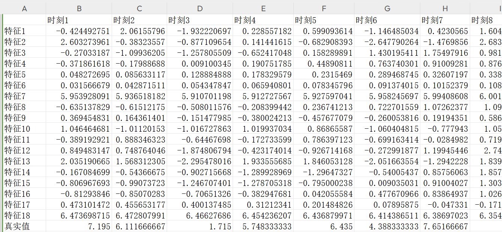
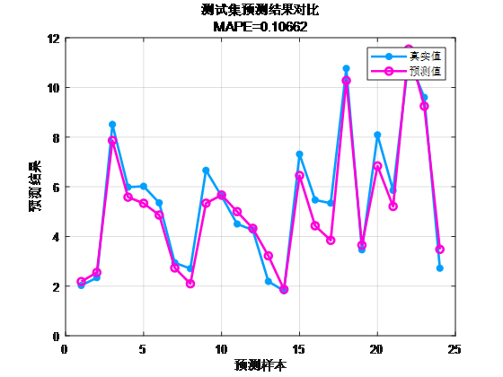
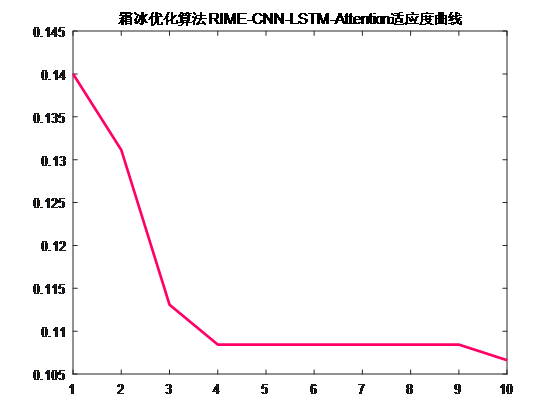
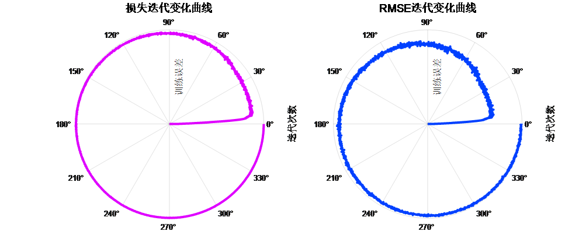
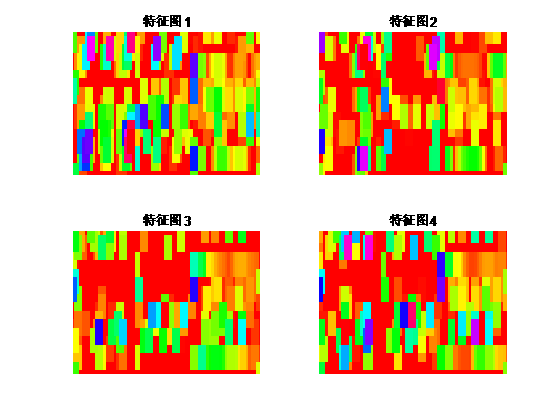

# 2023 New Optimization Prediction: RIME-CNN-LSTM-Attention Leads 24 Steps Multivariate Regression Prediction Algorithm

Program Platform: Suitable for MATLAB 2023 and above versions.
Code Explanation: The algorithm integrates the Frost Icing Optimization Algorithm (RIME), Convolutional Neural Network (CNN), and Long Short-Term Memory Network (LSTM) with a multihead self-attention mechanism to predict multiple variable time series ahead by 24 steps.
The Frost Icing Optimization Algorithm, published in the SCI journal "Neurocomputing" in 2023, is a new optimization algorithm that has not yet been applied in related literature. RIME primarily simulates the formation process of frost, cleverly applying it to the field of algorithm search.
① By simulating the movement of soft frost particles, the author proposes a novel algorithmic search strategy, namely the soft frost search strategy. This strategy is inspired by the simulation of the characteristics of soft frost particles in motion.
② Simultaneously, the article also simulates the cross behavior between hard frost particles, proposing a hard frost penetration mechanism to better utilize this algorithm. This penetration mechanism introduces a new optimization method for the algorithm through simulating the mutual crossing of hard frost particles.
③ Finally, improvements have been made in the selection mechanism of metaheuristic algorithms, introducing a forward greedy selection mechanism. The RIME algorithm is constructed by combining the soft frost search strategy, hard frost penetration mechanism, and forward greedy selection mechanism.
Functions:
1. Multivariate feature input, single sequence variable output, inputting the features of the previous day to make predictions for the next day, with an advance of 24 steps in prediction.
2. Optimizing learning rates, convolution kernel sizes, and number of neurons as three key parameters using the Frost Icing Optimization Algorithm, aiming to minimize the MAP E.
3. Providing loss, RMSE iterative change polar coordinates graph; network feature visualization graph; test comparison graph; fitness curve.
4. Providing calculation results such as MAP E, RMSE, MAE etc.
Applicable fields:
Wind speed prediction, photovoltaic power prediction, power generation power prediction, carbon price prediction, and other applications.
Input dataset format: 18 meteorological features per day, sampling time is 24 hours, output is the power output for the next day's 24 hours, which means 18×24 input and 1×24 output, there are a total of 75 such samples.

Prediction vs. actual results comparison:

Fitness curve:

Error iteration curve:

Visualization of extracted features:

## Images

<!-- PAYMENT_BLOCK -->

## Get this dataset

- Payment link (Stripe): [Buy now](https://buy.stripe.com/3cs8yP7sY87d0vu9AB)
- Payment QR code: 

<!-- /PAYMENT_BLOCK -->
